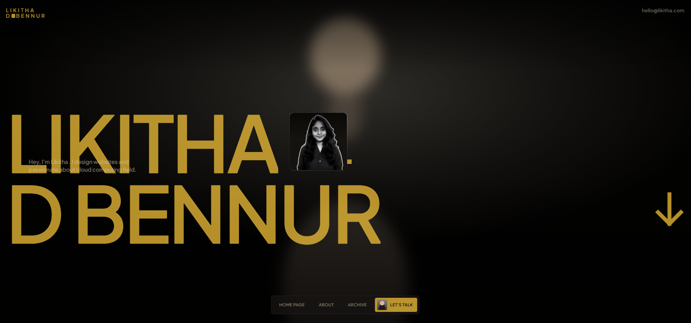
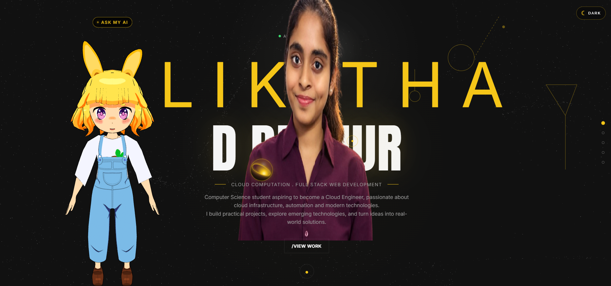

## 🌐 Live Demo

🔗 **[View Live Portfolio](https://animated-portfolio-ai-agent.vercel.app/)**

## 🖥️ Portfolio Preview

### Animated Landing Page

### Interactive Portfolio

## 📌 About the Project

This portfolio was designed and developed as a personal developer website to showcase my projects, technical skills, achievements, and development journey.

The project focuses on creating a visually engaging frontend experience through animations, interactive elements, responsive layouts, custom visual assets, and an interactive user interface.

## ✨ Key Features

- Interactive animated landing page
- Responsive frontend design
- Custom animations and visual elements
- Interactive AI feature
- Project showcase
- Skills and experience sections
- Resume access
- GitHub and LinkedIn integration
- Custom 3D and graphical assets
- Deployed and accessible online

## 🛠️ Technologies

- HTML5
- CSS3
- JavaScript
- Node.js / npm
- 3D assets
- API integration
- Vercel

## 🎯 Purpose

I built this portfolio to demonstrate my ability to create modern, interactive, and user-focused web experiences while presenting my software development projects and technical skills.

## 📚 What I Learned

- Building interactive frontend interfaces
- Creating animations and visual interactions
- Responsive web design
- JavaScript-based UI interactions
- Working with external APIs
- Integrating 3D assets
- Organizing a multi-section portfolio
- Deploying a frontend project using Vercel

## 👩‍💻 Author

**Likitha D. B.**

Information Science & Engineering Student  
GM Institute of Technology

🔗 **Portfolio:** https://animated-portfolio-ai-agent.vercel.app/

🔗 **GitHub:** https://github.com/likithadbennur2-creator
